# DOVE

**Learning Diffusion Policies from Accepted and Rejected Actions in Human-in-the-Loop Driving**

Anonymous Authors · Anonymous manuscript

[Project website](https://zhaobaibai2.github.io/DOVE/) · [Framework PDF](assets/images/framework/framework_overview.pdf)

[Overview](#physical-driving-overview) · [Method](#dove-training-and-deployment-pipeline) · [Physical results](#success-across-the-four-scenarios) · [Physical analysis](#physical-trajectories-and-dynamic-interactions) · [Simulation](#additional-simulation-results) · [Citation](#citation)

Click a video preview or **▶ Watch video** to play the full MP4. Click a figure to view the full-resolution image or PDF.

## Physical driving overview

[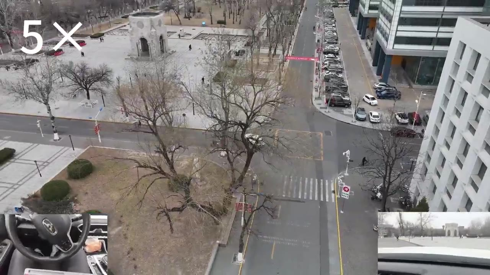](https://zhaobaibai2.github.io/DOVE/assets/videos/demos/route_overview.mp4)

[▶ Watch video](https://zhaobaibai2.github.io/DOVE/assets/videos/demos/route_overview.mp4)

DOVE is trained and repaired in closed-loop driving under human supervision.

## Abstract

Reinforcement learning can improve driving policies through closed-loop interaction, but trial-and-error training on physical vehicles is costly and unsafe. Human-in-the-loop (HIL) training reduces this burden by allowing a supervisor to override undesirable actions. Each takeover, however, provides more than an additional positive demonstration: at the same observation, the human action is executed and the autonomous action is explicitly rejected. For a multimodal diffusion actor, ignoring this rejected action can leave vetoed behavior in the sampling distribution. We therefore propose Diffusion with Observed Vetoes (DOVE), which preserves the same-state relation across actor learning, critic learning, and frozen execution. EnergyRank encodes the relation in an actor-derived denoising-compatibility margin, Critic Pairwise Calibration (CPCal) preserves it in twin proxy-risk critics, and deployment uses local critic guidance with a selective gate in which predicted proxy-risk reduction is the primary acceptance signal, while actor compatibility and critic agreement constrain the refinement before execution.

Under a matched MetaDrive HIL protocol, DOVE attains the highest observed success and return among learned-HIL baselines while using more than 70% fewer human-controlled steps than value-style methods. On a physical unmanned ground vehicle, the complete pipeline is repaired online under supervisor authority and then frozen. The frozen policy doubles the success count of a positive-only diffusion policy across four scenarios.

## Why offline training is not enough

We first train an initial policy from expert demonstrations. The policy works under the original training setup, but moving the obstacle is enough to expose a failure that was not covered by the demonstration data.

[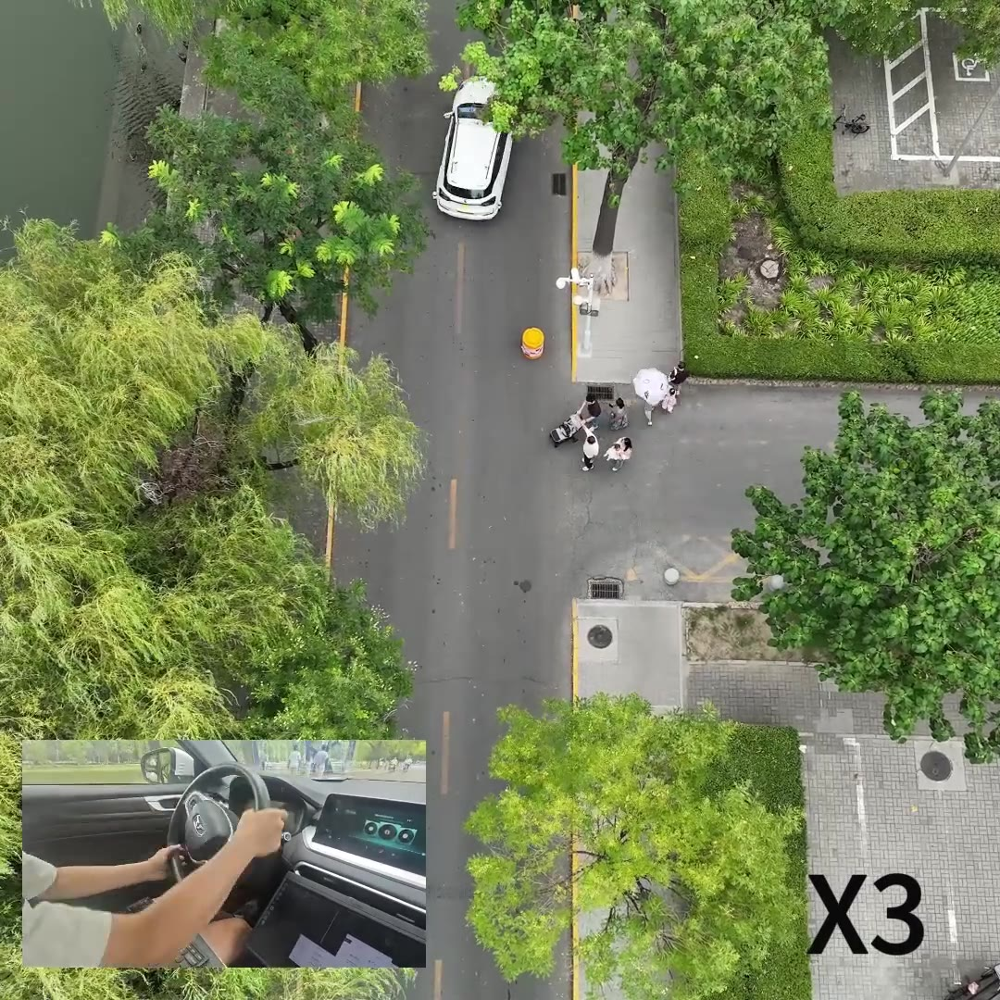](https://zhaobaibai2.github.io/DOVE/assets/videos/demos/expert_demonstration.mp4)

[▶ Watch video](https://zhaobaibai2.github.io/DOVE/assets/videos/demos/expert_demonstration.mp4)

**Expert demonstrations** — Collecting data for offline initialization

[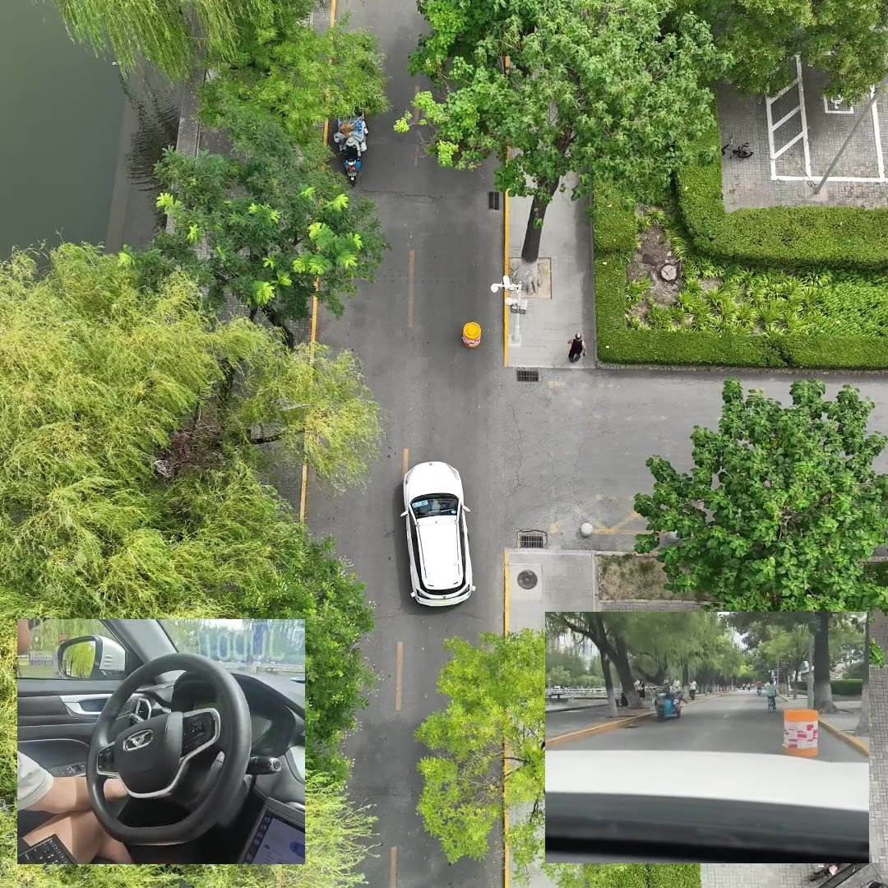](https://zhaobaibai2.github.io/DOVE/assets/videos/demos/offline_success.mp4)

[▶ Watch video](https://zhaobaibai2.github.io/DOVE/assets/videos/demos/offline_success.mp4)

**Initial policy** — The policy succeeds under the training setup

[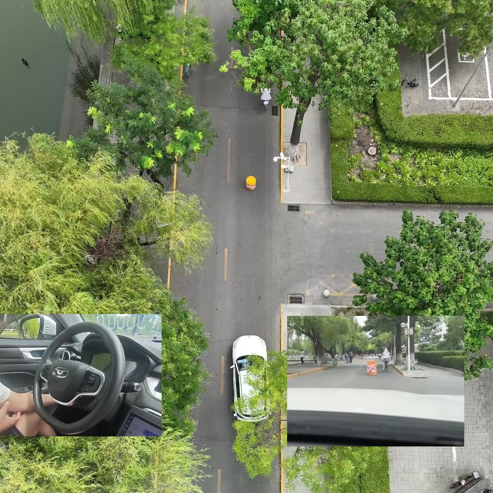](https://zhaobaibai2.github.io/DOVE/assets/videos/demos/distribution_shift_failure.mp4)

[▶ Watch video](https://zhaobaibai2.github.io/DOVE/assets/videos/demos/distribution_shift_failure.mp4)

**Distribution shift** — The same policy fails after the obstacle is moved

## What we learn from a human takeover

When the policy proposes an undesirable action, the supervisor takes control and executes a correction. DOVE keeps both actions at that same state: the accepted human action and the rejected autonomous action. The resulting pair tells the policy what to prefer and what to suppress during online repair.

rejected autonomous action  +  accepted human action  →  same-state veto pair

## DOVE training and deployment pipeline

We use each takeover pair to teach the policy which action should be preferred and which action should be suppressed. During online repair, the actor and critics are updated from the same intervention stream; all parameters and thresholds are then frozen before deployment.

EnergyRank writes the accepted–rejected ordering into the diffusion actor, while CPCal preserves it in the twin proxy-risk critics. At deployment, local critic guidance proposes a lower-risk action and a selective gate decides whether to execute that refinement.

[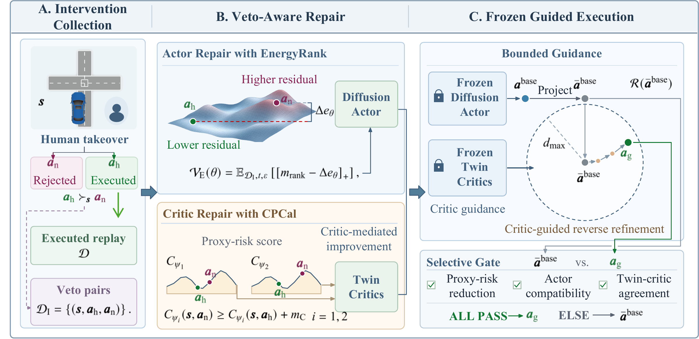](assets/images/framework/framework_overview.pdf)

A takeover pair is used for actor-side and critic-side learning during online repair; the repaired actor, critics, and gate are frozen for closed-loop deployment.

[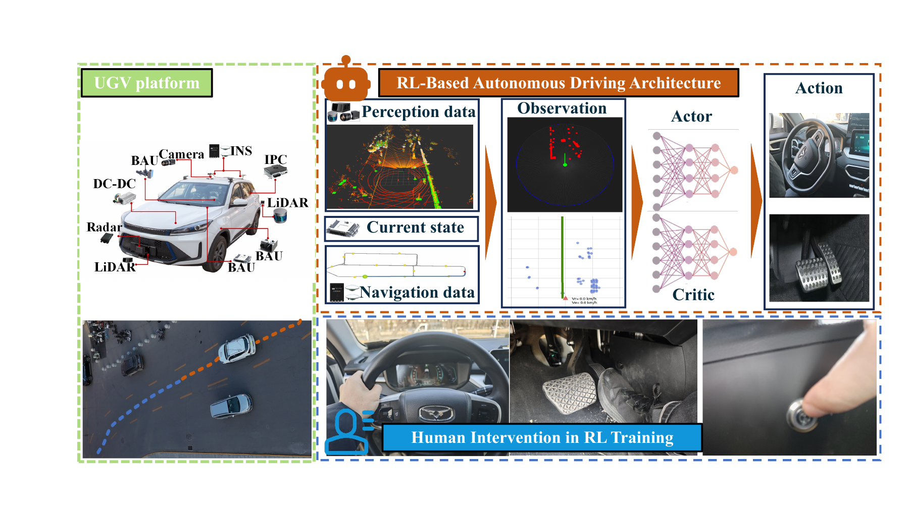](assets/images/motivation/physical_platform.png)

*The physical UGV logs synchronized autonomous, supervisor, and executed actions.*

## Online repair with human supervision

Online repair is performed on Route 1. The supervisor can take control whenever the current policy produces an undesirable action, and the resulting intervention pairs are used to update the actor and critics.

[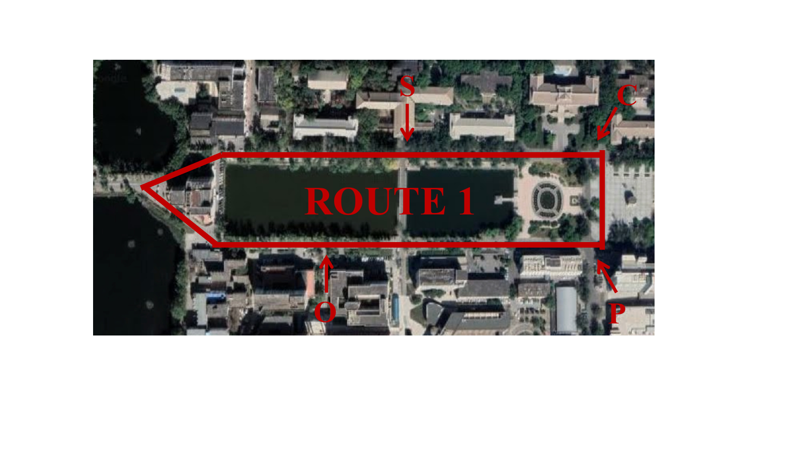](assets/images/results/route1_map.png)

*Route 1 is used for human-supervised data collection and policy repair.*

[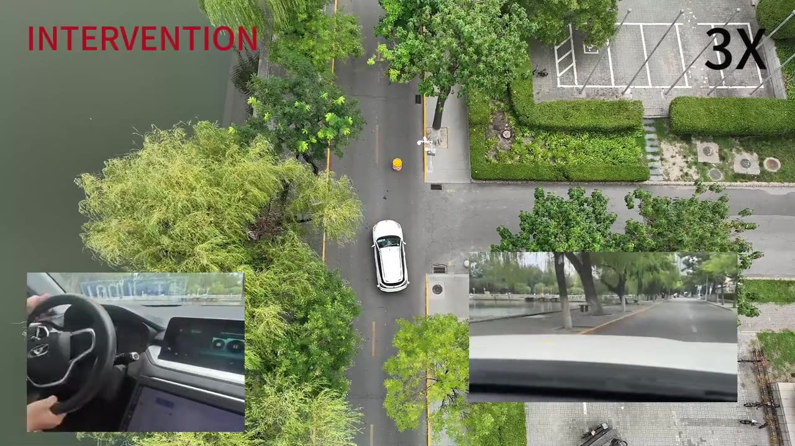](https://zhaobaibai2.github.io/DOVE/assets/videos/demos/online_hitl_adaptation.mp4)

[▶ Watch video](https://zhaobaibai2.github.io/DOVE/assets/videos/demos/online_hitl_adaptation.mp4)

*The supervisor intervenes while the policy is repaired online.*

[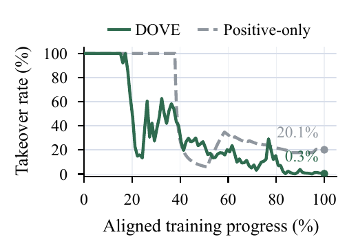](assets/images/results/intervention_burden.png)

*Takeover rate during online repair on Route 1.*

At the beginning of online repair, the supervisor still intervenes frequently. As training continues, the takeover rate decreases, so the policy completes more of the route without human control. DOVE shows a faster reduction than the positive-only diffusion baseline.

## Freezing the repaired policy

Once online repair is complete, we freeze the actor, critics, gate thresholds, and all other learned parameters. Human supervision is no longer part of learning, and the frozen systems are evaluated independently in closed-loop driving tasks.

## Closed-loop physical UGV evaluation

After repair is finished, the frozen policies are evaluated from matched start states and scripts in four physical driving scenarios. Each scenario has 10 trials; a collision or emergency takeover counts as failure.

[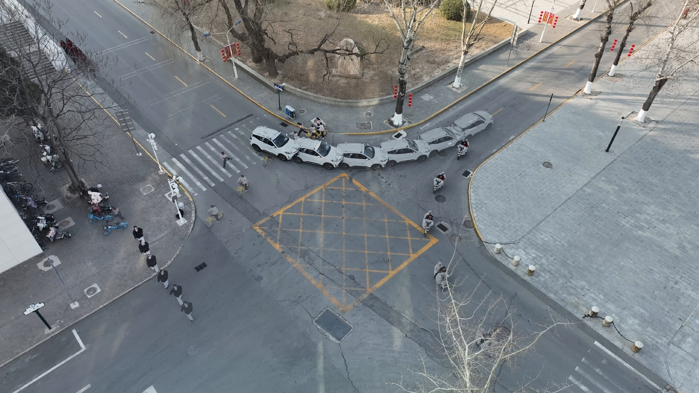](assets/images/gallery/curve_meeting.jpg)

*Curve meeting (C)*

[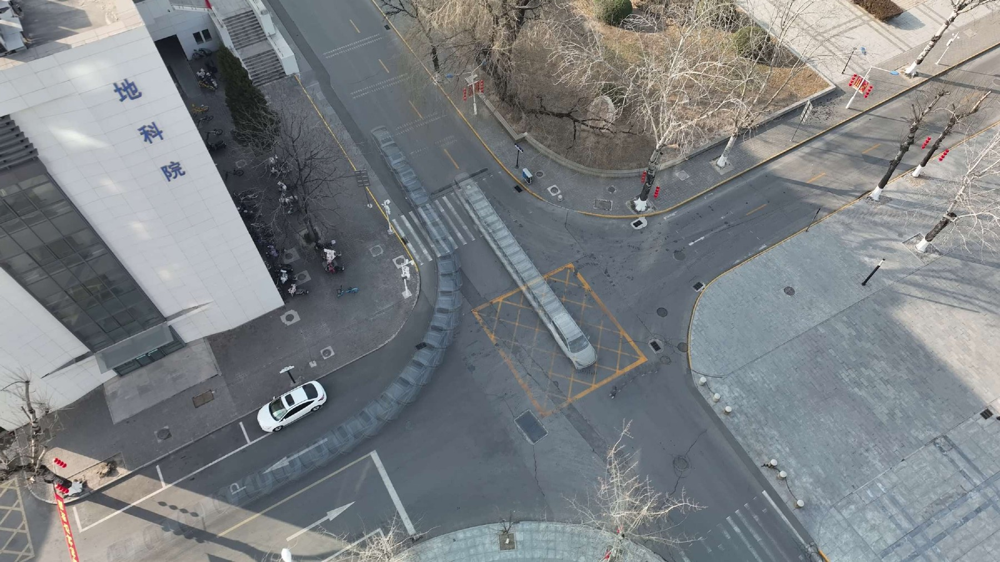](assets/images/gallery/pedestrian_yielding.jpg)

*Pedestrian yielding (P)*

[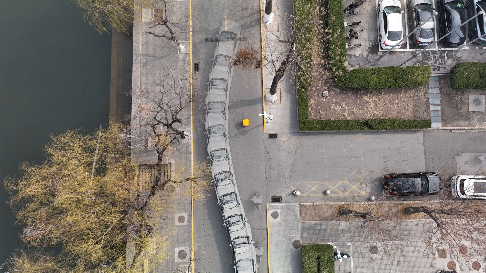](assets/images/gallery/obstacle_avoidance.jpg)

*Obstacle avoidance (O)*

[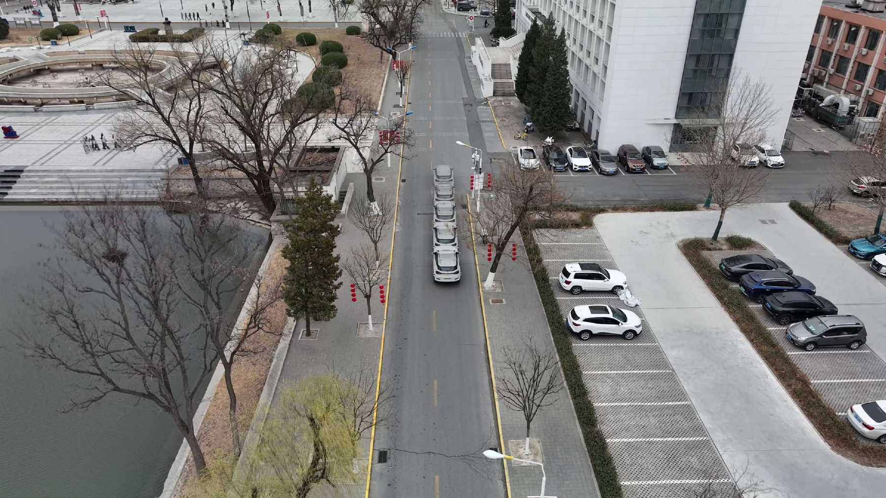](assets/images/gallery/straight_lane_keeping.jpg)

*Straight lane keeping (S)*

## Success across the four scenarios

DOVE succeeds in 8/10, 8/10, 7/10, and 9/10 trials across curve meeting, pedestrian yielding, obstacle avoidance, and straight lane keeping, giving an overall success rate of 0.80. The positive-only diffusion policy reaches 0.40 overall success under the same evaluation protocol.

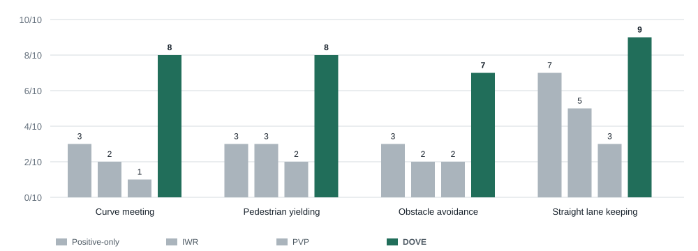

Besides success rate, we report speed, lateral tracking error, and jerk. Speed is reported descriptively; lateral error and jerk are lower-is-better metrics.

| Method | Speed | Lat. MAE ↓ | Jerk ↓ | Success ↑ | C/P/O/S ↑ |
| --- | --- | --- | --- | --- | --- |
| Positive-only | 1.25 ± 0.52 | 1.31 ± 1.03 | 2.53 ± 0.39 | 0.40 | 3/3/3/7 |
| IWR | 1.74 ± 0.78 | 1.10 ± 0.39 | 3.06 ± 0.92 | 0.30 | 2/3/2/5 |
| PVP | 0.62 ± 0.26 | 0.47 ± 0.29 | 1.90 ± 1.37 | 0.20 | 1/2/2/3 |
| DOVE | 1.39 ± 0.75 | 0.51 ± 0.36 | 1.16 ± 0.20 | 0.80 | 8/8/7/9 |

Speed: m s<sup>−1</sup>; lateral MAE: m; jerk: m s<sup>−3</sup>. Values are frame-level mean ± standard deviation. C/P/O/S denotes successful trials (n/10) in curve meeting, pedestrian yielding, obstacle avoidance, and straight lane keeping.

## Physical trajectories and dynamic interactions

Recorded obstacle-avoidance trajectories and dynamic interactions on the physical UGV. Control traces use the logged maneuver-phase onset as t = 0, with A–D marking the annotated control events.

[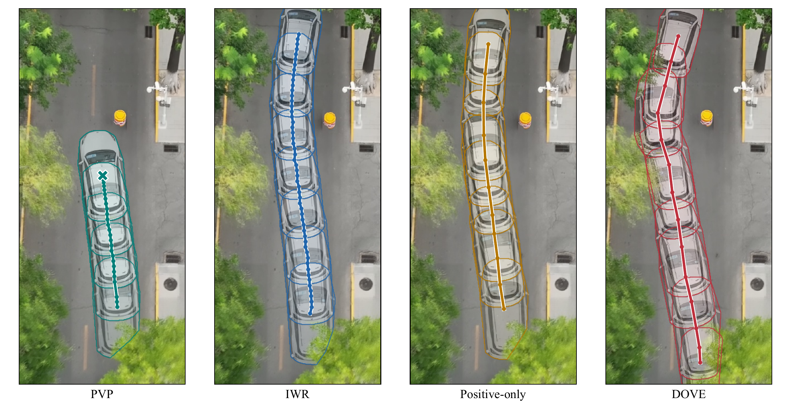](assets/images/results/trajectory_individual_views.pdf)

*Obstacle-avoidance trajectories of PVP, IWR, Positive-only, and DOVE (left to right). [PDF](assets/images/results/trajectory_individual_views.pdf)*

[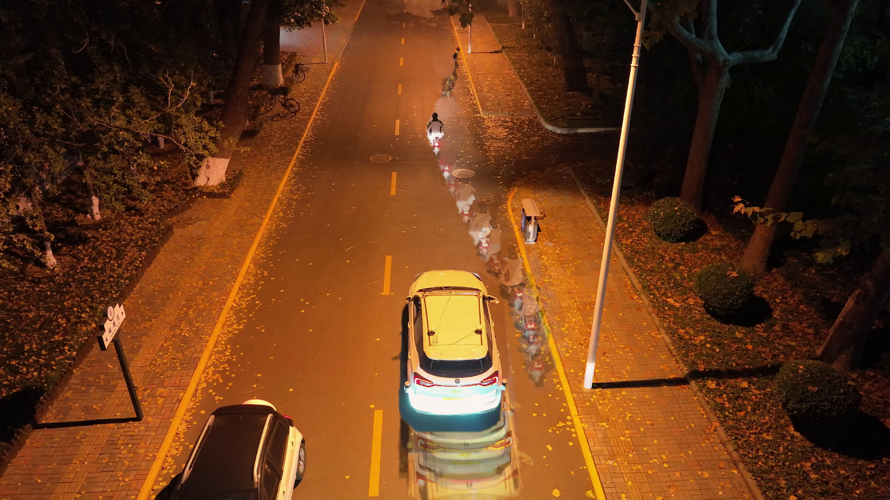](assets/images/results/fig_dynamic_cyclist_yielding.pdf)

*Cyclist yielding: the ego vehicle decelerates and stops to yield to an overtaking cyclist. [PDF](assets/images/results/fig_dynamic_cyclist_yielding.pdf)*

[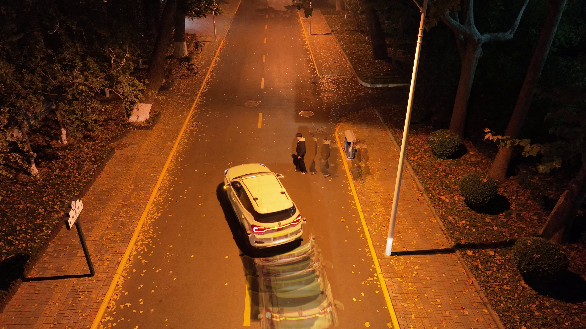](assets/images/results/fig_dynamic_pedestrian_crossing.pdf)

*Pedestrian crossing avoidance: the ego vehicle combines deceleration with steering correction. [PDF](assets/images/results/fig_dynamic_pedestrian_crossing.pdf)*

[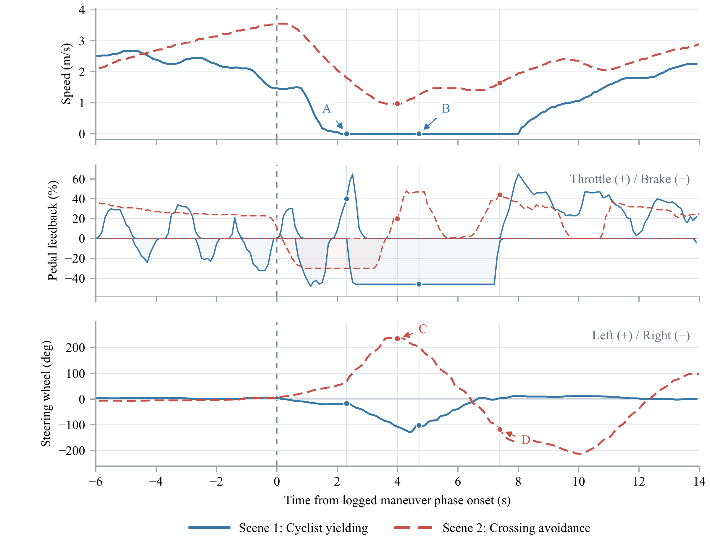](assets/images/results/fig_dynamic_control_feedback.pdf)

*Speed, pedal feedback, and steering-wheel feedback in the two dynamic interactions. [PDF](assets/images/results/fig_dynamic_control_feedback.pdf)*

### Route 1 physical-UGV phase-level data-path audit

| Phase | Rows | Logged decisions | Acceptance rate | Fallback rate |
| --- | --- | --- | --- | --- |
| Collection | 7,514 | 375 | 0.005 | 0.995 |
| Online repair | 22,362 | 1,104 | 0.746 | 0.254 |
| Frozen execution | 2,629 | 131 | 0.985 | 0.015 |

### Mean onboard timing on the physical UGV

| Component | Latency (ms) | Period (ms) | Rate (Hz) |
| --- | --- | --- | --- |
| Diffusion-only | 33.35 | 100.08 | 9.99 |
| DOVE | 154.22 | 170.12 | 5.88 |
| Vehicle interface | 0.82 | 105.48 | 9.48 |

## Additional physical demonstrations

### Obstacle avoidance

[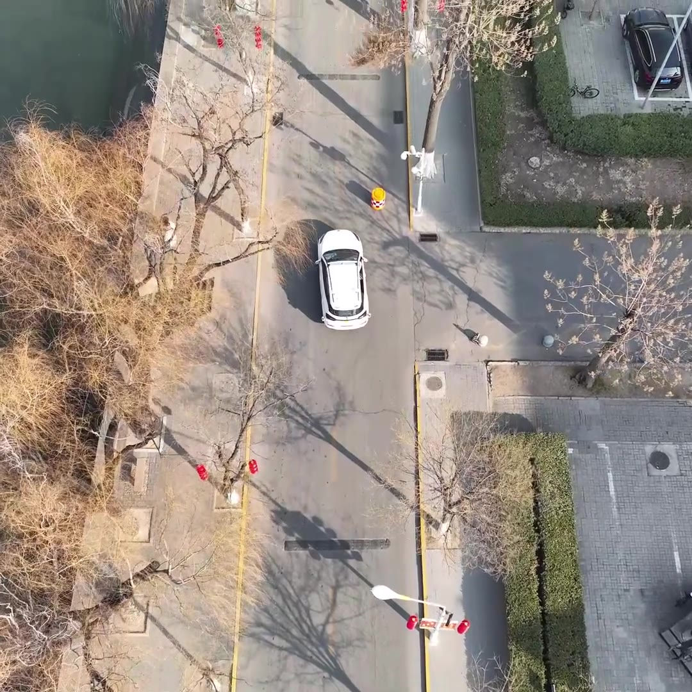](https://zhaobaibai2.github.io/DOVE/assets/videos/comparisons/obstacle_policy.mp4)

[▶ Watch video](https://zhaobaibai2.github.io/DOVE/assets/videos/comparisons/obstacle_policy.mp4)

*H-DSAC policy*

[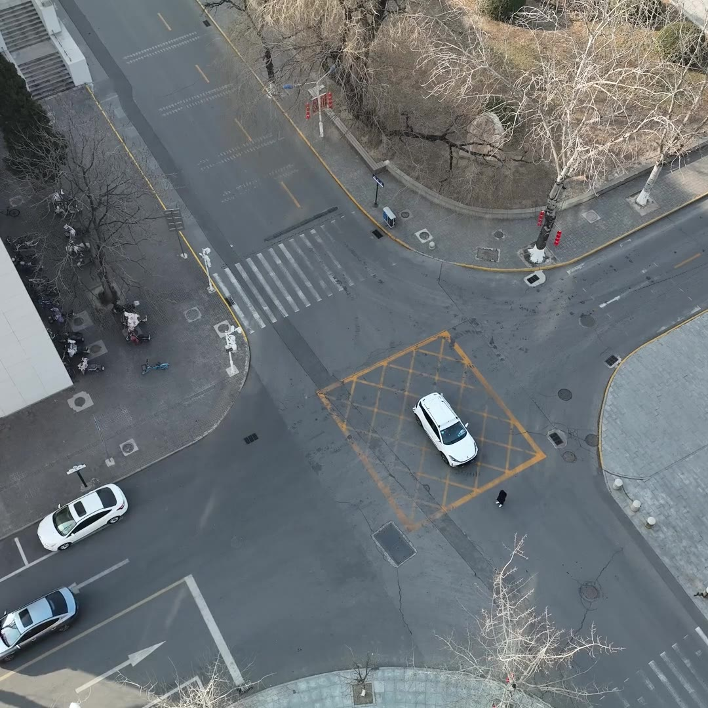](https://zhaobaibai2.github.io/DOVE/assets/videos/comparisons/obstacle_baseline_failure.mp4)

[▶ Watch video](https://zhaobaibai2.github.io/DOVE/assets/videos/comparisons/obstacle_baseline_failure.mp4)

*Baseline failure case*

### Pedestrian crossing

[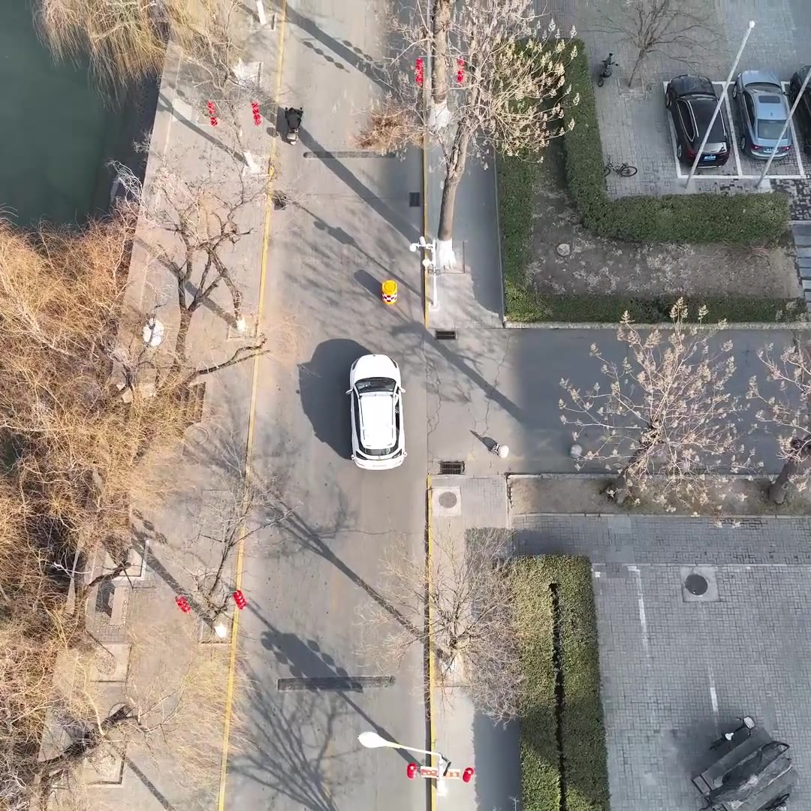](https://zhaobaibai2.github.io/DOVE/assets/videos/comparisons/pedestrian_policy.mp4)

[▶ Watch video](https://zhaobaibai2.github.io/DOVE/assets/videos/comparisons/pedestrian_policy.mp4)

*H-DSAC policy*

[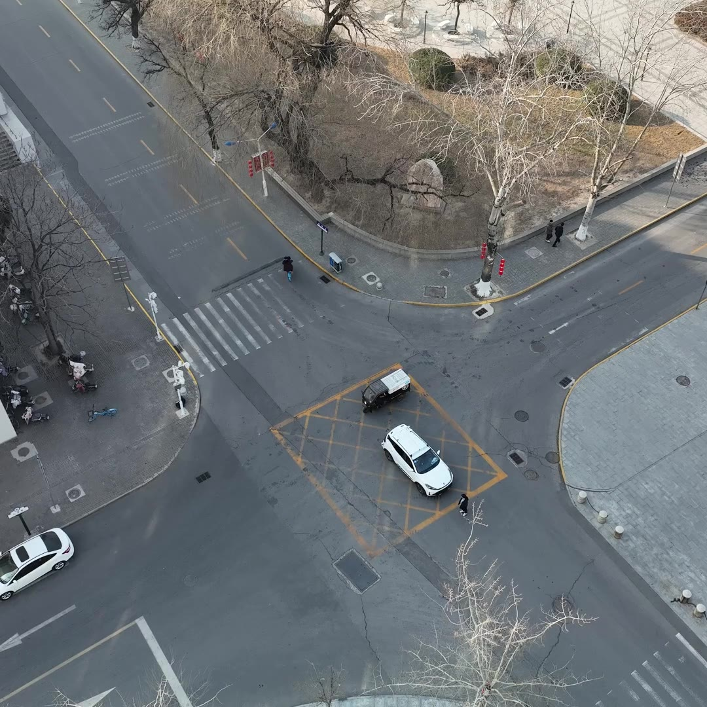](https://zhaobaibai2.github.io/DOVE/assets/videos/comparisons/pedestrian_baseline_failure.mp4)

[▶ Watch video](https://zhaobaibai2.github.io/DOVE/assets/videos/comparisons/pedestrian_baseline_failure.mp4)

*Baseline failure case*

### Turning

[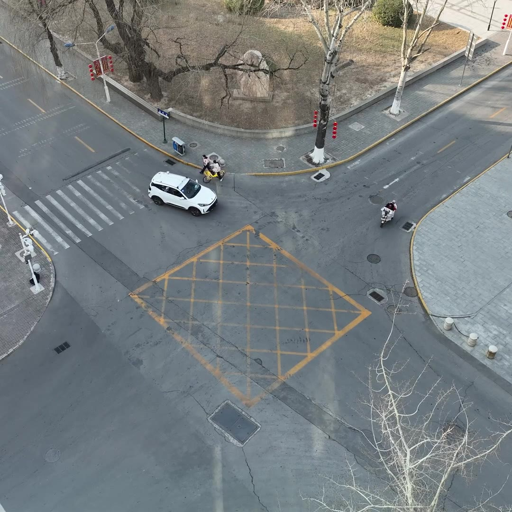](https://zhaobaibai2.github.io/DOVE/assets/videos/comparisons/turning_policy.mp4)

[▶ Watch video](https://zhaobaibai2.github.io/DOVE/assets/videos/comparisons/turning_policy.mp4)

*H-DSAC policy*

[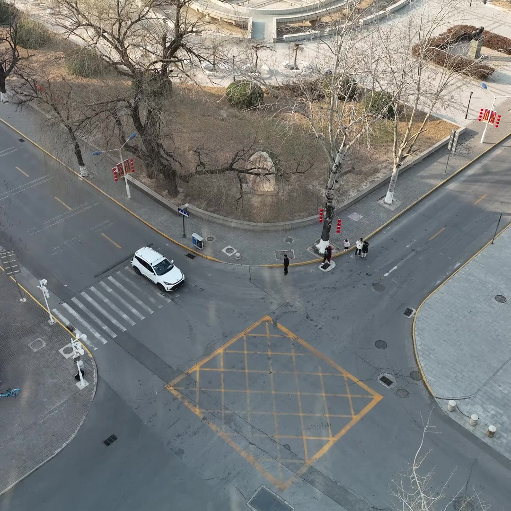](https://zhaobaibai2.github.io/DOVE/assets/videos/comparisons/turning_baseline_failure.mp4)

[▶ Watch video](https://zhaobaibai2.github.io/DOVE/assets/videos/comparisons/turning_baseline_failure.mp4)

*Baseline failure case*

## Additional simulation results

We also evaluate training in MetaDrive. Reward and takeover-rate curves provide a second view of learning progress over each method’s logged training horizon.

[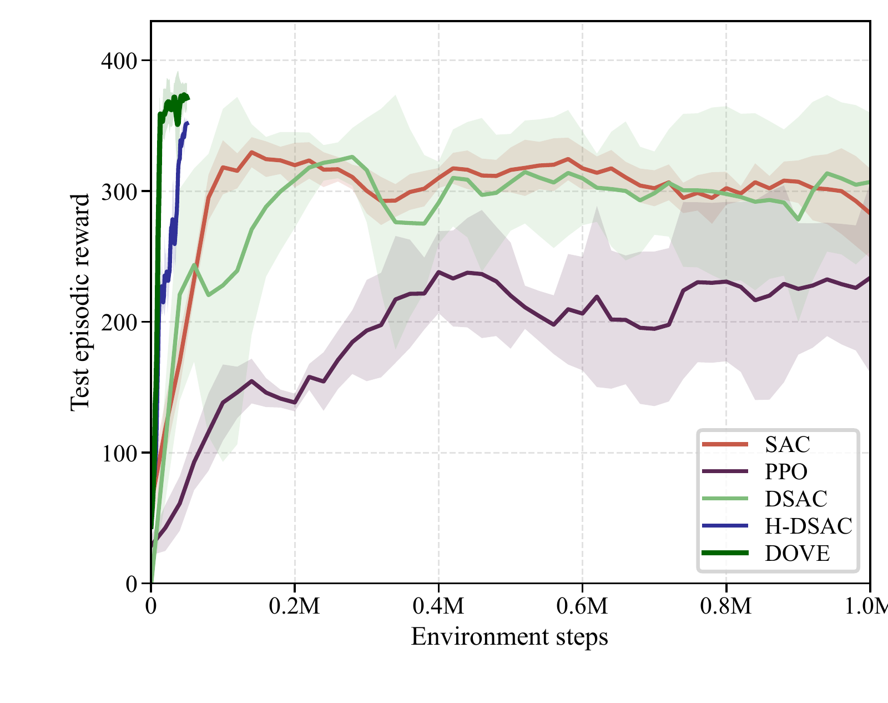](assets/images/results/simulation_reward.png)

*Test episodic reward during MetaDrive training.*

[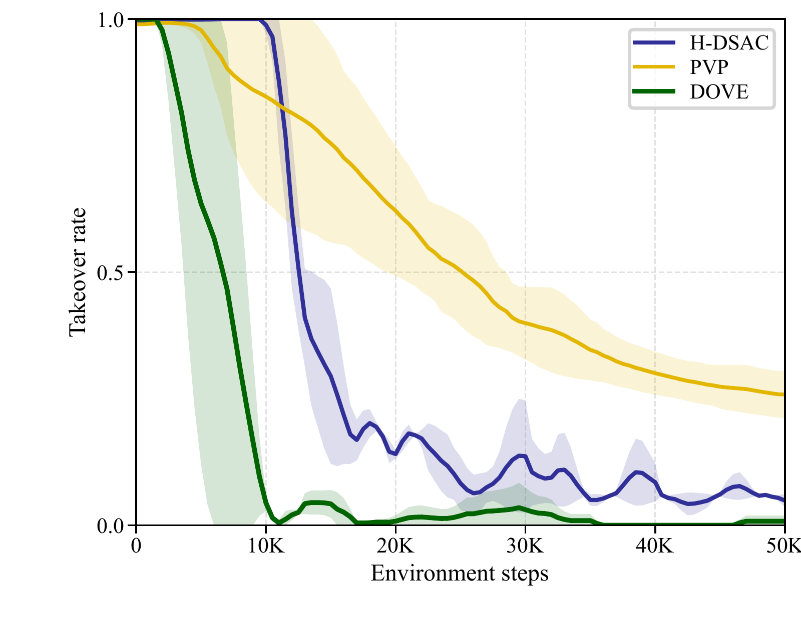](assets/images/results/simulation_takeover.png)

*Takeover rate during MetaDrive training.*

### Dynamic traffic interactions

The red vehicle is the ego vehicle. Other colored vehicles represent surrounding traffic; timestamps are shown in each frame.

[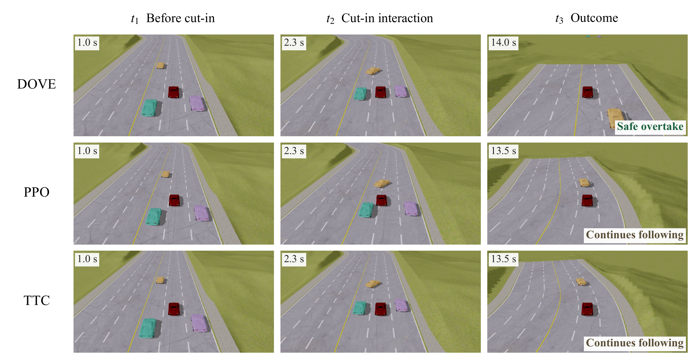](assets/images/results/M1_phase_aligned.pdf)

*M1: Dynamic vehicle cut-in. Rows compare DOVE, PPO, and TTC before cut-in, during interaction, and at the outcome. [PDF](assets/images/results/M1_phase_aligned.pdf)*

[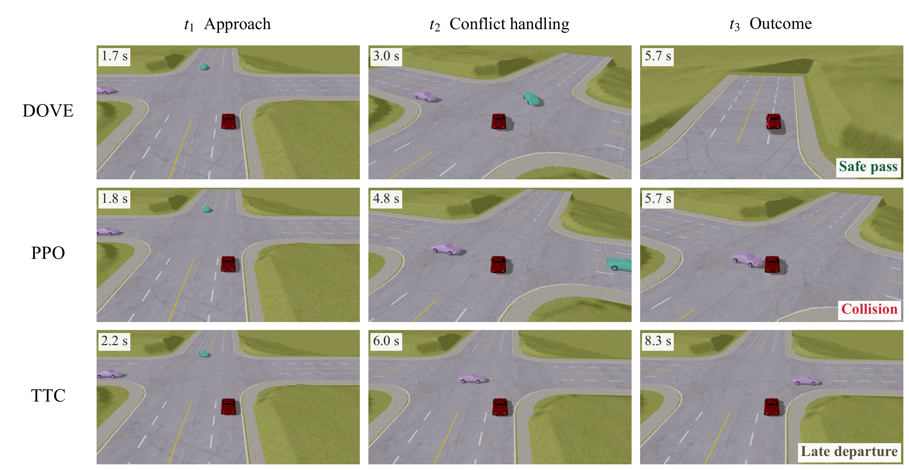](assets/images/results/M2_phase_aligned.pdf)

*M2: Intersection conflict. Rows compare DOVE, PPO, and TTC during approach, conflict handling, and at the outcome. [PDF](assets/images/results/M2_phase_aligned.pdf)*

### MetaDrive closed-loop comparison

Training protocols differ across groups. Learned-HIL methods use the matched 0.05M online-step protocol; standard online RL and diffusion-RL baselines use 1M steps, while offline methods use 50K human demonstrations.

| Method | Human-controlled steps ↓ | Online env. steps | Train safety cost ↓ | Return ↑ | Test cost ↓ | Success ↑ |
| --- | --- | --- | --- | --- | --- | --- |
| Human Demo. | 50K | N/A | 23 | 377.52 | 0.39 | 0.97 |
| SAC | N/A | 1M | 7.94K ± 3.24K | 350.18 ± 16.21 | 1.00 ± 0.28 | 0.73 ± 0.13 |
| PPO | N/A | 1M | 45.12K ± 21.11K | 278.65 ± 35.07 | 3.92 ± 1.91 | 0.44 ± 0.14 |
| DSAC | N/A | 1M | 7.44K ± 3.59K | 349.35 ± 22.15 | 0.47 ± 0.08 | 0.77 ± 0.09 |
| CQL | 50K | N/A | N/A | 93.12 ± 16.31 | 1.45 ± 0.15 | 0.09 ± 0.05 |
| BC | 50K | N/A | N/A | 59.13 ± 8.92 | 0.12 ± 0.03 | 0.00 ± 0.00 |
| Diffusion-QL | N/A | 1M | 5,634 | 366.79 ± 16.78 | 0.11 ± 0.07 | 0.88 ± 0.03 |
| DACER | N/A | 1M | 1,092 | 369.78 ± 15.38 | 0.10 ± 0.04 | 0.89 ± 0.01 |
| HG-DAgger | 34.9K | 0.05M | 56.13 | 142.35 | 2.10 | 0.30 |
| IWR | 37.1K | 0.05M | 48.78 | 329.97 | 4.00 | 0.70 |
| PVP | 15.7K | 0.05M | 33.67 ± 3.46 | 338.28 ± 10.21 | 0.65 ± 0.12 | 0.80 ± 0.03 |
| H-DSAC | 14.8K | 0.05M | 32.12 ± 4.68 | 353.39 ± 12.34 | 0.31 ± 0.03 | 0.83 ± 0.05 |
| DOVE | 4.2K | 0.05M | 23.18 | 368.16 ± 6.88 | 0.03 ± 0.03 | 0.95 ± 0.03 |

### Actor- and critic-side diagnostics

EnergyRank and CPCal are enabled (✓) or disabled (✗). The last row is Full DOVE.

| EnergyRank | CPCal | ρ_VLB ↑ | HSR ↑ | RMR_0.5 ↓ | Mean critic PairAcc ↑ |
| --- | --- | --- | --- | --- | --- |
| ✗ | ✗ | 0.619 | 0.615 | 0.295 | 0.983 |
| ✓ | ✗ | 0.989 | 0.981 | 0.007 | 0.345 |
| ✗ | ✓ | 0.772 | 0.722 | 0.189 | 0.987 |
| ✓ | ✓ | 0.821 | 0.772 | 0.151 | 0.980 |

### Inference-side execution-mode ablation

The Full-DOVE training configuration is held fixed while inference modes are varied.

| Inference mode | Success ↑ | Collision ↓ | Route ↑ | Ep. reward ↑ |
| --- | --- | --- | --- | --- |
| Actor only (no guidance) | 0.400 | 0.400 | 0.768 | 288.53 |
| Top-8 rerank | 0.388 | 0.500 | 0.703 | 261.45 |
| Guidance, always execute | 0.472 | 0.490 | 0.658 | 244.14 |
| Guidance, loss-only gate | 0.492 | 0.470 | 0.647 | 240.55 |
| Guidance, proxy-only gate | 0.770 | 0.230 | 0.854 | 322.30 |
| Guidance, w/o disagreement | 0.838 | 0.162 | 0.874 | 330.81 |
| Guidance, full gate | 0.842 | 0.158 | 0.883 | 330.76 |

## Citation

```bibtex
@misc{dove,
  title  = {DOVE: Learning Diffusion Policies from Accepted and Rejected Actions in Human-in-the-Loop Driving},
  author = {{Anonymous Authors}},
  note   = {Anonymous manuscript}
}
```

[Physical results CSV](02_data/current_paper/website_results.csv) · [Physical results JSON](02_data/current_paper/website_results.json) · [Paper tables JSON](02_data/current_paper/paper_tables.json)

## Preview the project website locally

```bash
python3 -m http.server 8000
```

Open http://localhost:8000.
